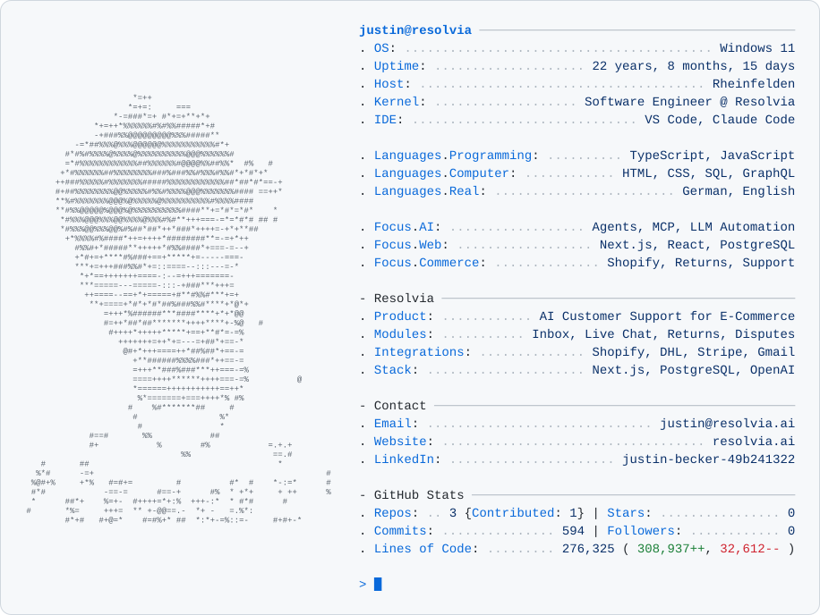

<!-- Generated by scripts/build.mjs from profile.config.json; edit those, not this file. -->

<picture>
  <source media="(prefers-color-scheme: dark)" srcset="assets/card-dark.dd7a4d0a0c.svg">
  
</picture>

<a href="https://resolvia.ai"><picture>
  <source media="(prefers-color-scheme: dark)" srcset="assets/button-0-dark.5ae65d4add.svg">
  
</picture></a>
<a href="https://www.linkedin.com/in/justin-becker-49b241322/"><picture>
  <source media="(prefers-color-scheme: dark)" srcset="assets/button-1-dark.6b60828513.svg">
  
</picture></a>
<a href="mailto:justin@resolvia.ai"><picture>
  <source media="(prefers-color-scheme: dark)" srcset="assets/button-2-dark.4c88a05478.svg">
  
</picture></a>

<picture>
  <source media="(prefers-color-scheme: dark)" srcset="assets/contributions-dark.e6e524464f.svg">
  
</picture>

